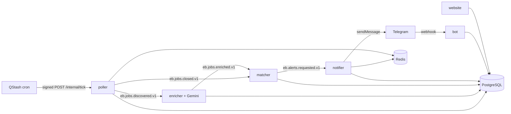

# EarlyBird

[](https://github.com/yuvrajtiwary-bitmesraece/earlybird/actions/workflows/ci.yml)

EarlyBird sends you a Telegram alert within minutes of a matching job going live on a company's careers page, with your match score and the skills you're missing.

> **Status:** under construction. Blocks 1–2 of 13 are done: the project skeleton, and polling 130 real job boards. Live links arrive with the deployment in Block 8. The full design is in [docs/earlybird-spec.md](docs/earlybird-spec.md); design decisions and trade-offs are in [docs/interview-notes.md](docs/interview-notes.md).

## How it works

1. **Poll:** every 3 minutes, EarlyBird checks 130 companies' Greenhouse, Lever and Ashby job boards for new postings.
2. **Tag:** Gemini reads each new posting and extracts role, seniority, years of experience, location, work mode and skills.
3. **Match:** each posting is scored against every user's roles, locations, experience and skills.
4. **Alert:** good matches go out on Telegram at once, with **Apply** and feedback buttons; the rest arrive in a daily digest at 20:00 IST.

## Architecture

One Spring Boot app whose modules talk only through an `EventBus` interface. `EARLYBIRD_ROLES` decides which modules a process runs: on Render all of them run in one container; in Kubernetes each role is its own Deployment, with no code change.



## Stack

| Area | Choice |
|---|---|
| Runtime | Java 25 (virtual threads) |
| Framework | Spring Boot 4.2 |
| Database | PostgreSQL 17 (Supabase) via `JdbcClient` + Flyway, no ORM |
| Messaging | Kafka (Aiven) in production; an in-process bus locally |
| Cache / locks / rate limits | Redis (Upstash) |
| AI | Gemini API (`gemini-3.5-flash-lite`) |
| Tests | JUnit 5, AssertJ, Testcontainers, Awaitility, JaCoCo |
| CI | GitHub Actions |

## Run it locally (no Docker needed)

You need **JDK 25** only; the Maven wrapper downloads Maven itself.

1. Copy `.env.example` to `.env` and fill it in (database, a *dev* Telegram bot, Gemini key). `.env` is gitignored.
2. Start the app:
   ```bash
   ./mvnw spring-boot:run        # Windows: mvnw.cmd spring-boot:run
   ```
   The `local` profile is the default and reads `.env`. Locally the event bus is in-process (`EVENT_BUS=memory`) and jobs are scheduled inside the app (`SCHEDULER_MODE=internal`).
3. Check it: <http://localhost:8080/actuator/health/readiness> should say `UP`.

If a setting is missing or wrong, startup stops with a list of every problem, each naming the environment variable to fix.

## Job sources

| Platform | Endpoint | Trustworthy publish time | Notes |
|---|---|---|---|
| Greenhouse | `boards-api.greenhouse.io/v1/boards/{token}/jobs` | `first_published` (not `updated_at`, which changes on every edit) | Light list every check; descriptions only for new jobs. Company boilerplate blocks are dropped |
| Lever | `api.lever.co/v0/postings/{site}?mode=json` | none (`createdAt` is when the draft was created, sometimes months earlier) | Descriptions included; requirement lists are put first so they survive the 3,000-character cut |
| Ashby | `api.ashbyhq.com/posting-api/job-board/{name}` | `publishedAt` | Descriptions included; unlisted jobs skipped |

- **Seed list:** [`seed-boards.csv`](src/main/resources/boards/seed-boards.csv) has 130 companies that currently list jobs in India or remote jobs open to India. It was found by trying ~740 candidate companies on all three platforms, then checking each board's identity and job locations. It is loaded at startup (insert-if-absent).
- **Check the list** (no database or web server needed):
  ```bash
  java -jar target/earlybird.jar --validate-boards     # writes reports/board-validation.csv
  ```
- **The first check of a board is a baseline:** jobs already on the board are stored (so closures can be detected) but not alerted. Only those the platform says were published in the last 48 hours go on to tagging.
- **Unchanged boards cost almost nothing:** each board's ETag is sent back as `If-None-Match`, and an unchanged board answers `304 Not Modified` with no body.

## Tests

```bash
./mvnw verify
```

- **Unit tests** (`*Test`) always run.
- **Integration tests** (`*IT`) start the whole app against a real Postgres in Docker (Testcontainers). Without Docker they are skipped, so they skip on a laptop without Docker and always run in CI. CI fails if they were skipped.
- Coverage: `target/site/jacoco/index.html` (also uploaded by CI).

## Measured numbers

| Date | What | Result | Environment |
|---|---|---|---|
| 2026-11-24 | Startup, schema already migrated | 7.3 s | Laptop, JDK 25, app in India talking to Supabase in Singapore |
| 2026-11-24 | Memory after startup (RSS) | 231 MB | Same, `-Xmx300m -XX:+UseSerialGC` |
| 2026-11-24 | `--validate-boards`, 130 boards | 10 s, 130/130 valid | Laptop |
| 2026-11-24 | First tick (baseline of 130 boards) | 33 s; 16,336 jobs stored, 295 sent on for tagging; 0 failures | Laptop → live boards + Supabase Singapore |
| 2026-11-24 | Steady-state tick | 17 s; 129 of 130 boards answered 304 Not Modified | Same |
| 2026-11-24 | Peak memory during the baseline tick (RSS) | 321 MB | Same, `-Xmx300m` |

Production figures (Render, 0.1 CPU / 512 MB) will be added in Block 8.

## Project layout

```
src/main/java/io/github/yuvrajtiwary/earlybird/
  config/       typed configuration, roles, @ConditionalOnRole
  common/       UUID v7 ids, rate limiter
  events/       EventBus interface, envelope, in-memory bus, event payloads
  sources/      Greenhouse / Lever / Ashby clients, HTTP client, seed list, board validator
  poller/       per-board check (diff, baseline, reposts, empty guard), tick
  ops/          distributed lock, internal scheduler
  persistence/  JdbcClient repositories and table records
src/main/resources/db/migration/   Flyway migrations
src/main/resources/boards/         seed-boards.csv
src/test/resources/fixtures/       real API responses used by the parser tests
```

Later blocks add `enrich/`, `profiles/`, `matching/`, `alerts/`, `telegram/` and `web/`.

## License

[MIT](LICENSE)
