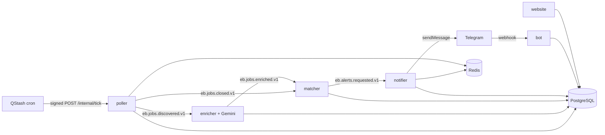

# EarlyBird

[](https://github.com/yuvrajtiwary-bitmesraece/earlybird/actions/workflows/ci.yml)

EarlyBird sends you a Telegram alert within minutes of a matching job going live on a company's careers page, with your match score and the skills you're missing.

> **Status:** under construction. Block 1 of 13 (project skeleton) is done. Live links arrive with the deployment in Block 8. The full design is in [docs/earlybird-spec.md](docs/earlybird-spec.md); design decisions and trade-offs are in [docs/interview-notes.md](docs/interview-notes.md).

## How it works

1. **Poll:** every 3 minutes, EarlyBird checks ~150 companies' Greenhouse, Lever and Ashby job boards for new postings.
2. **Tag:** Gemini reads each new posting and extracts role, seniority, years of experience, location, work mode and skills.
3. **Match:** each posting is scored against every user's roles, locations, experience and skills.
4. **Alert:** good matches go out on Telegram at once, with **Apply** and feedback buttons; the rest arrive in a daily digest at 20:00 IST.

## Architecture

One Spring Boot app whose modules talk only through an `EventBus` interface. `EARLYBIRD_ROLES` decides which modules a process runs: on Render all of them run in one container; in Kubernetes each role is its own Deployment, with no code change.



## Stack

| Area | Choice |
|---|---|
| Runtime | Java 25 (virtual threads) |
| Framework | Spring Boot 4.2 |
| Database | PostgreSQL 17 (Supabase) via `JdbcClient` + Flyway, no ORM |
| Messaging | Kafka (Aiven) in production; an in-process bus locally |
| Cache / locks / rate limits | Redis (Upstash) |
| AI | Gemini API (`gemini-3.5-flash-lite`) |
| Tests | JUnit 5, AssertJ, Testcontainers, Awaitility, JaCoCo |
| CI | GitHub Actions |

## Run it locally (no Docker needed)

You need **JDK 25** only; the Maven wrapper downloads Maven itself.

1. Copy `.env.example` to `.env` and fill it in (database, a *dev* Telegram bot, Gemini key). `.env` is gitignored.
2. Start the app:
   ```bash
   ./mvnw spring-boot:run        # Windows: mvnw.cmd spring-boot:run
   ```
   The `local` profile is the default and reads `.env`. Locally the event bus is in-process (`EVENT_BUS=memory`) and jobs are scheduled inside the app (`SCHEDULER_MODE=internal`).
3. Check it: <http://localhost:8080/actuator/health/readiness> should say `UP`.

If a setting is missing or wrong, startup stops with a list of every problem, each naming the environment variable to fix.

## Tests

```bash
./mvnw verify
```

- **Unit tests** (`*Test`) always run.
- **Integration tests** (`*IT`) start the whole app against a real Postgres in Docker (Testcontainers). Without Docker they are skipped, so they skip on a laptop without Docker and always run in CI. CI fails if they were skipped.
- Coverage: `target/site/jacoco/index.html` (also uploaded by CI).

## Measured numbers

| Date | What | Result | Environment |
|---|---|---|---|
| 2026-11-24 | Startup, schema already migrated | 7.3 s | Laptop, JDK 25, app in India talking to Supabase in Singapore |
| 2026-11-24 | Memory after startup (RSS) | 231 MB | Same, `-Xmx300m -XX:+UseSerialGC` |

Production figures (Render, 0.1 CPU / 512 MB) will be added in Block 8.

## Project layout

```
src/main/java/io/github/yuvrajtiwary/earlybird/
  config/       typed configuration, roles, @ConditionalOnRole
  common/       UUID v7 ids, rate limiter
  events/       EventBus interface, envelope, in-memory bus
  ops/          distributed lock
  persistence/  JdbcClient repositories and table records
src/main/resources/db/migration/   Flyway migrations
```

Later blocks add `sources/`, `poller/`, `enrich/`, `profiles/`, `matching/`, `alerts/`, `telegram/` and `web/`.

## License

[MIT](LICENSE)
