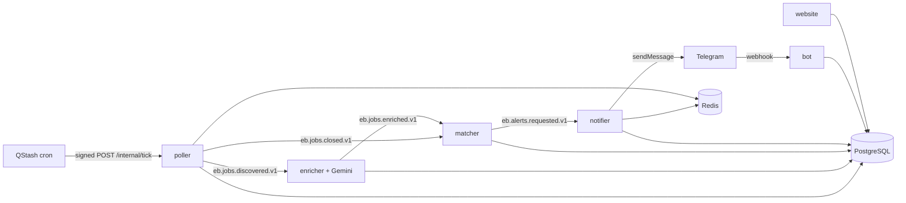

# EarlyBird

[](https://github.com/yuvrajtiwary-bitmesraece/earlybird/actions/workflows/ci.yml)

EarlyBird sends you a Telegram alert within minutes of a matching job going live on a company's careers page, with your match score and the skills you're missing.

> **Status:** under construction. Blocks 1–6 of 13 are done: the project skeleton, polling 130 real job boards, the Telegram bot (onboarding, resume parsing, commands), tagging, matching and alerts, the Kafka event bus, and scheduling with QStash. Live links arrive with the deployment in Block 8. The full design is in [docs/earlybird-spec.md](docs/earlybird-spec.md); design decisions and trade-offs are in [docs/interview-notes.md](docs/interview-notes.md).

## How it works

1. **Poll:** every 3 minutes, EarlyBird checks 130 companies' Greenhouse, Lever and Ashby job boards for new postings.
2. **Tag:** Gemini reads each new posting and extracts role, seniority, years of experience, location, work mode and skills.
3. **Match:** each posting is scored against every user's roles, locations, experience and skills.
4. **Alert:** good matches go out on Telegram at once, with **Apply** and feedback buttons; the rest arrive in a daily digest at 20:00 IST.

## Architecture

One Spring Boot app whose modules talk only through an `EventBus` interface. `EARLYBIRD_ROLES` decides which modules a process runs: on Render all of them run in one container; in Kubernetes each role is its own Deployment, with no code change.



## Stack

| Area | Choice |
|---|---|
| Runtime | Java 25 (virtual threads) |
| Framework | Spring Boot 4.2 |
| Database | PostgreSQL 17 (Supabase) via `JdbcClient` + Flyway, no ORM |
| Messaging | Kafka (Aiven) in production; an in-process bus locally |
| Cache / locks / rate limits | Redis (Upstash) |
| AI | Gemini API (`gemini-3.5-flash-lite`) |
| Tests | JUnit 5, AssertJ, Testcontainers, Awaitility, JaCoCo |
| CI | GitHub Actions |

## Run it locally (no Docker needed)

You need **JDK 25** only; the Maven wrapper downloads Maven itself.

1. Copy `.env.example` to `.env` and fill it in (database, a *dev* Telegram bot, Gemini key). `.env` is gitignored.
2. Start the app:
   ```bash
   ./mvnw spring-boot:run        # Windows: mvnw.cmd spring-boot:run
   ```
   The `local` profile is the default and reads `.env`. Locally the event bus is in-process (`EVENT_BUS=memory`) and jobs are scheduled inside the app (`SCHEDULER_MODE=internal`).
3. Check it: <http://localhost:8080/actuator/health/readiness> should say `UP`.
4. Talk to it: open your **dev** bot in Telegram and send `/start`. Locally the bot long-polls Telegram (`TELEGRAM_MODE=polling`), so no public URL is needed. Use a separate dev bot: a bot can have a webhook or be polled, never both, so polling the production bot would break production.

If a setting is missing or wrong, startup stops with a list of every problem, each naming the environment variable to fix.

## The Telegram bot

- **Onboarding:** `/start` walks through roles, locations, experience, internships and an optional resume PDF, then turns alerts on. Progress is stored in `bot_sessions`, so a restart mid-way loses nothing.
- **Commands:** `/prefs`, `/skills` (`add Kafka, Docker` / `remove PHP`), `/upload`, `/pause`, `/unpause`, `/stats`, `/delete`, `/help`, `/cancel`. The admin chat also has `/admin` and `/admin_tick`.
- **Resumes:** the PDF is read in memory (first 5 pages). Emails, phone numbers, links, addresses and the name line are removed, and only then is the text sent to Gemini, which extracts skills, years of full-time experience, graduation year and suggested roles. Only those facts and the file's SHA-256 are kept; the file and its text are not. The consent text is shown before every upload.
- **Production** uses a webhook (`POST /telegram/webhook`) checked with a secret header; duplicate deliveries are ignored, and each user's updates are handled in order.

## Job sources

| Platform | Endpoint | Trustworthy publish time | Notes |
|---|---|---|---|
| Greenhouse | `boards-api.greenhouse.io/v1/boards/{token}/jobs` | `first_published` (not `updated_at`, which changes on every edit) | Light list every check; descriptions only for new jobs. Company boilerplate blocks are dropped |
| Lever | `api.lever.co/v0/postings/{site}?mode=json` | none (`createdAt` is when the draft was created, sometimes months earlier) | Descriptions included; requirement lists are put first so they survive the 3,000-character cut |
| Ashby | `api.ashbyhq.com/posting-api/job-board/{name}` | `publishedAt` | Descriptions included; unlisted jobs skipped |

- **Seed list:** [`seed-boards.csv`](src/main/resources/boards/seed-boards.csv) has 130 companies that currently list jobs in India or remote jobs open to India. It was found by trying ~740 candidate companies on all three platforms, then checking each board's identity and job locations. It is loaded at startup (insert-if-absent).
- **Check the list** (no database or web server needed):
  ```bash
  java -jar target/earlybird.jar --validate-boards     # writes reports/board-validation.csv
  ```
- **The first check of a board is a baseline:** jobs already on the board are stored (so closures can be detected) but not alerted. Only those the platform says were published in the last 48 hours go on to tagging.
- **Unchanged boards cost almost nothing:** each board's ETag is sent back as `If-None-Match`, and an unchanged board answers `304 Not Modified` with no body.

## Tagging, matching and alerts

- **Tagging:** a new posting waits in Postgres until it is tagged (its description is kept only until then). A worker claims up to 15 at a time (`FOR UPDATE SKIP LOCKED`, with a 5-minute lease in case it dies) and sends them to Gemini in one call, as `p1`…`p15`, asking for schema-constrained JSON. Every field is validated and skills are normalized through [`skills.yaml`](src/main/resources/skills.yaml). Postings the model leaves out are retried once in a half-size batch.
- **Fallback:** when Gemini fails after 3 tries or the day's budget (`GEMINI_MAX_CALLS_PER_DAY`) is spent, a keyword tagger takes over, so alerts never wait on Gemini. Its rows are marked `tagger = fallback`.
- **Matching:** each tagged posting is compared with every active user who chose its role. A posting must pass three filters: location (a chosen city, with Delhi NCR and Mumbai treated as regions, or remote in India or worldwide), experience, and internships only if wanted.
  - Score (0–100) = 65 × share of the posting's main skills you have + 20 × experience fit + 15 × location fit.
  - Below 40: nothing. At or above your minimum (default 55): an instant alert. In between: the evening digest. Jobs found on a board's first check always go to the digest.
- **Alerts:** title, company, location, score, the skills you have and the ones you're missing, with **Apply**, optional **Prep**, and 👍 / 👎 buttons.
  - **No duplicates:** each alert is a row with a unique (user, posting) key, and it is claimed (`queued → sending`) before it is sent. A redelivered event or a re-run tick can't alert the same user twice about the same job.
  - **Limits:** a daily cap per user (default 10; past it, matches go to the digest), one message per second per chat, and 25 per second overall (Telegram's bulk limit is about 30).
  - **Failures:** Telegram 403 (the user blocked the bot) marks the user blocked; 429 and 5xx are retried.
- **Digest:** at 20:00 IST each user gets one message with their top 10 queued matches of the day.
- **Recent matches:** finishing onboarding or changing preferences sends the top 3 matches from the last 48 hours, so a new user doesn't start with silence.
- **Redis is optional.** It holds the shared send rate, daily cap counters and a weekly "who's hiring freshers" ranking. With `REDIS_URL` empty, or Redis unreachable (then retried after 30 s), rates are limited in memory and caps are counted in Postgres.

## Events and Kafka

| Topic | Key | Producer → consumer group |
|---|---|---|
| `eb.jobs.discovered.v1` | posting id | poller → `eb-enricher` |
| `eb.jobs.enriched.v1` | posting id | enricher → `eb-matcher` |
| `eb.jobs.closed.v1` | posting id | poller → `eb-matcher` |
| `eb.alerts.requested.v1` | user id (one user's alerts stay in order) | matcher → `eb-notifier` |
| `eb.dlq.v1` | the original key | any consumer → `eb-admin` (admin notice) |

- **One interface, two buses.** `EVENT_BUS=memory` (the local default: in-process, nothing to install) or `EVENT_BUS=kafka` (production, on Aiven's free plan). Modules only call `EventBus.publish` and `subscribe`.
- **At-least-once delivery, no duplicates for users:**
  - The producer waits for every in-sync replica (`acks=all`, idempotent, zstd).
  - A consumer commits an event's offset only after its handler, and the handler's database transaction, has finished. After a crash the event comes again, and consumers skip what they've already handled: `processed_events` for the matcher, the alert's status for the notifier, the database queue for the tagger.
- **Failures:** retried after 1 s, 5 s and 30 s, then written to `eb.dlq.v1` with the error, the attempt count and the original message (base64). Malformed events go there at once. The admin gets a Telegram notice (at most one per topic per day), and `/admin` shows the count.
- **Outbox relay:** producers write Postgres first and mark a row published only once Kafka has confirmed its event. At the end of every tick the relay publishes whatever is still unmarked: postings and tags over a minute old, and instant alerts still queued after 2 minutes.
- **When Kafka is down** (for example, Aiven powered the free service off), the app keeps running:
  - Health says `DEGRADED` (HTTP 200). Readiness is unaffected, so the platform doesn't restart the app.
  - Events wait in Postgres, and publishing fails at once instead of waiting on timeouts.
  - The admin is told after 5 minutes, and the relay catches up when Kafka is back.
- **Topics are created by hand** (auto-creation is off). Startup logs a clear error naming any that are missing.
- **Setting up Aiven** (free, no card):
  1. Create a Kafka service on the Free tier, and its five topics with 2 partitions each.
  2. Download the CA certificate, access certificate and access key into a folder.
  3. Put the service URI in `.env` as `KAFKA_BOOTSTRAP_SERVERS`.
  4. Run `java scripts/KafkaPemsToEnv.java <folder>`. It checks the files belong together and writes them into `.env` as one-line PEM text (no keystore files), printing only OK/FAIL.
- **Dev and prod share Aiven's single free service.** Outside production, consumer groups carry the environment's name (`dev.eb-matcher`), so a laptop can't take events away from production. Once production is live, run dev on the in-process bus anyway.

## Scheduling and maintenance

| Endpoint | When (QStash schedule) | Does |
|---|---|---|
| `POST /internal/tick` | every 3 minutes | checks boards that are due, then runs the outbox relay |
| `POST /internal/digest` | 20:00 IST | sends the daily digests |
| `POST /internal/maintenance` | 03:30 IST | retention cleanup, re-enables disabled boards that answer again |

- **Signed calls only.** Each call must carry QStash's `Upstash-Signature`, a JWT checked against the current or the next signing key, for exactly this URL, not expired, and with a matching body hash. Anything else gets **401**.
- **202 at once, work in the background.** A valid call takes the job's lock and answers `202` with `started`, or `skipped` if the previous run still holds the lock. Overlapping ticks can't happen.
- **Locks:** Redis `SET NX PX`, released only by its owner. When Redis is off or down, a Postgres advisory lock takes over; Postgres frees it if the process dies.
- **Locally** (`SCHEDULER_MODE=internal`), the same jobs run on timers inside the app, through the same locks.
- **Failing boards back off:** the n-th failure in a row waits 3 × 2^(n−1) minutes, at most an hour. The 20th disables the board and tells the admin; maintenance re-enables it if it answers again.
- **Admin notices** also cover 3 failed ticks in a row, and more than 20% of boards failing.
- **Retention:** closed postings after 60 days, alerts after 180, processed events after 7, Telegram updates after 2, ticks after 30, and untagged descriptions after 7.

## Tests

```bash
./mvnw verify
```

- **Unit tests** (`*Test`) always run.
- **Integration tests** (`*IT`) start the whole app against a real Postgres in Docker (Testcontainers), and `KafkaPipelineIT` adds a real Kafka (`apache/kafka`) with `EVENT_BUS=kafka`. Without Docker they are skipped, so they skip on a laptop without Docker and always run in CI. CI fails if they were skipped.
- Coverage: `target/site/jacoco/index.html` (also uploaded by CI).

## Measured numbers

| Date | What | Result | Environment |
|---|---|---|---|
| 2026-11-24 | Startup, schema already migrated | 7.3 s | Laptop, JDK 25, app in India talking to Supabase in Singapore |
| 2026-11-24 | Memory after startup (RSS) | 231 MB | Same, `-Xmx300m -XX:+UseSerialGC` |
| 2026-11-24 | `--validate-boards`, 130 boards | 10 s, 130/130 valid | Laptop |
| 2026-11-24 | First tick (baseline of 130 boards) | 33 s; 16,336 jobs stored, 295 sent on for tagging; 0 failures | Laptop → live boards + Supabase Singapore |
| 2026-11-24 | Steady-state tick | 17 s; 129 of 130 boards answered 304 Not Modified | Same |
| 2026-11-24 | Peak memory during the baseline tick (RSS) | 321 MB | Same, `-Xmx300m` |
| 2026-11-24 | New jobs detected in the first hour after the baseline | 9 (0 failures); a Stripe job published at 17:46 was found at 17:46 | Laptop, ticks every 3 min |
| 2026-11-24 | One resume through Gemini (`gemini-3.5-flash-lite`) | ~1.6 s, ~1,200 input tokens | Real API call, synthetic resume |
| 2026-11-24 | Tagging the backlog from the baseline plus new jobs | 275 postings in 20 batches. Gemini answered 4 batches (47 postings); 16 got 503 "high demand" after 3 tries and went to the keyword fallback | Laptop → Gemini API, IST evening |
| 2026-11-24 | Memory with every module running (poller, tagging, matcher, notifier, bot) | 253 MB peak working set | Laptop, `-Xmx300m -XX:+UseSerialGC` |
| 2026-11-24 | New postings, 18:45–20:00 IST | 16 new jobs, all senior or non-technical, so 0 matches (correct) | Laptop, ticks every 3 min |
| 2026-11-27 | Startup with `EVENT_BUS=kafka` | 19.8 s; all 5 topics found, 4 consumer groups assigned partitions within 7 s | Laptop → Aiven free Kafka (Asia Pacific), client-certificate TLS |
| 2026-11-27 | First tick after a two-day gap | 579 new postings in 53 s; 554 published to Kafka (the rest were reposts) | Same |
| 2026-11-27 | Job first seen → instant alert sent, through Kafka | 18 s, 18 s and 27 s for the first three real alerts | Same; Gemini tagging 15 per call |
| 2026-11-27 | Memory with every module and Kafka | 248 MB working set, 373 MB peak during the 579-posting catch-up, 74 threads | Same, `-Xmx300m -XX:+UseSerialGC` |
| 2026-11-27 | `/internal/*` with tokens signed by the real QStash keys | unsigned / wrong key / token for another URL: 401; signed tick: 202 started; a second tick while it ran: 202 skipped; maintenance: 202, deleted 13 old Telegram updates | Laptop, `SCHEDULER_MODE=external`, Postgres advisory lock through the Supabase session pooler |
| 2026-11-27 | Tick with 124 of 130 boards unchanged | 25.6 s; 3 new postings, 62 closed | Same |
| 2026-11-27 | Kafka unreachable at startup | App started (14.6 s), health `DEGRADED`, readiness `UP`, one log line per outage | Laptop, Kafka pointed at a closed port |

Production figures (Render, 0.1 CPU / 512 MB) will be added in Block 8.

## Project layout

```
src/main/java/io/github/yuvrajtiwary/earlybird/
  config/       typed configuration, roles, @ConditionalOnRole
  common/       UUID v7 ids, rate limiter, city names, Redis guard and Redis rate limiter
  events/       EventBus interface, envelope, in-memory and Kafka buses, Kafka monitor, outbox relay, payloads
  sources/      Greenhouse / Lever / Ashby clients, HTTP client, seed list, board validator
  poller/       per-board check (diff, baseline, reposts, empty guard), tick
  enrich/       Gemini client and daily budget, batch tagger, fallback tagger, tagging worker, skill vocabulary
  matching/     match rules (filters, score, routing), matcher, recent matches
  alerts/       notifier, message format, daily caps, digest
  profiles/     resume pipeline (PDF text, contact stripping, Gemini), profile service
  telegram/     Bot API client, webhook + polling, onboarding, commands, feedback buttons, admin
  ops/          distributed lock, internal scheduler, admin notices
  persistence/  JdbcClient repositories and table records
src/main/resources/db/migration/   Flyway migrations
src/main/resources/boards/         seed-boards.csv
src/main/resources/skills.yaml     canonical skill names and aliases
src/main/resources/prompts/        Gemini system instructions
src/test/resources/fixtures/       real API responses used by the parser tests
scripts/KafkaPemsToEnv.java        Aiven's certificate files → .env
```

Later blocks add `web/`.

## License

[MIT](LICENSE)
